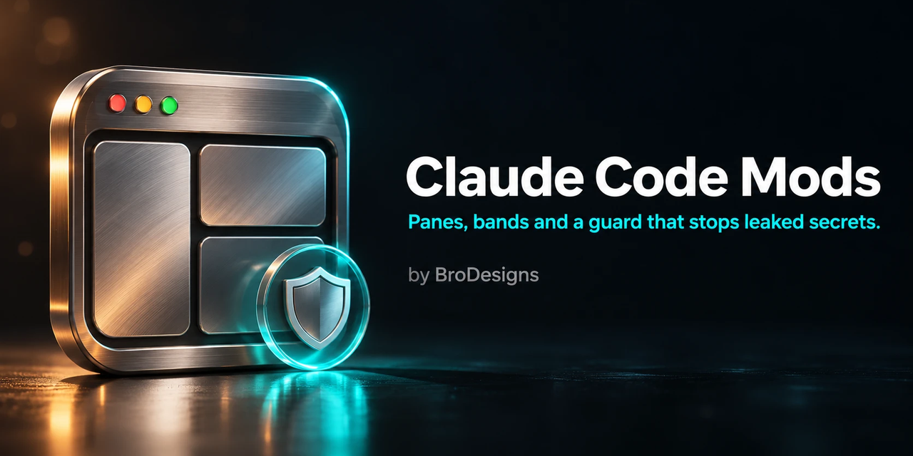
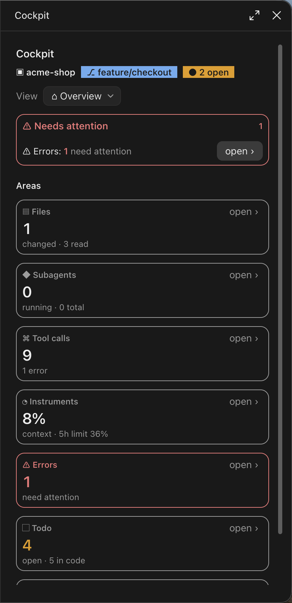
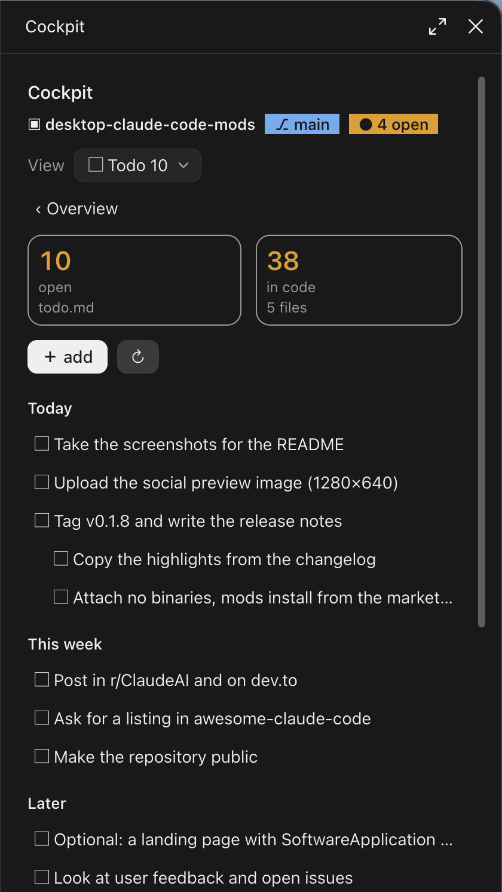
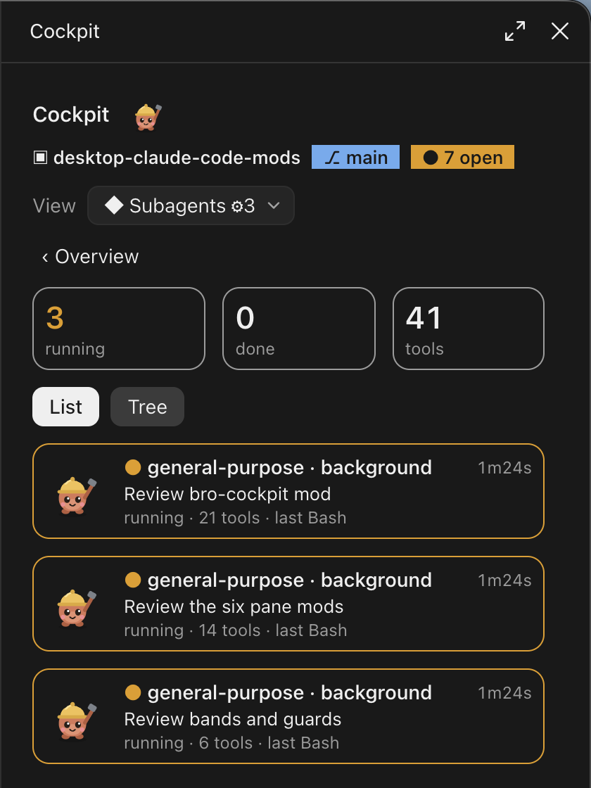

<p align="center"></p>

# Claude Code Desktop Mods: Session Dashboard, Prompt Bands, Panes and Guards

[](LICENSE)
-D97757)


**Plugins (mods) for Claude Code in the Claude desktop app.** Add a live session dashboard pane next to the chat, small status bands above the prompt (git, branch warning, environment, usage limits, deadline, daily totals), panes for prompts, snippets, a kanban board, Bash logs and dependencies, and a hook that stops Claude from writing API keys and passwords into files or shell commands. Mods run in the Claude Code plugin engine, not in the model, so they cost no extra tokens, with one deliberate exception named in [Security and privacy](#security-and-privacy): `session-summary` calls a small model.

> **Not an official Anthropic project.** Claude and Claude Code are trademarks of Anthropic. This repository is not affiliated with or endorsed by Anthropic.

## All 13 mods

One marketplace, 13 mods: **1 dashboard, 1 guard hook, 5 bands, 6 panes**. Every mod is its own plugin, so you install only the ones you want. Each has its own README in `mods/<name>/` with all commands and settings.

### Dashboard (1)

| Mod | What it does | Command |
|---|---|---|
| [`bro-cockpit`](mods/bro-cockpit) | Dashboard pane with eight tabs (overview, files read and changed, subagent tree, tool calls, context and rate limit meter, errors, todo.md checklist and code markers, project ideas) plus a git band above the prompt | `/cockpit`, `/idea`, `/change` |

### Guard hook (1)

| Mod | What it does | Command |
|---|---|---|
| [`secret-guard`](mods/secret-guard) | Blocks API keys, tokens, private keys and plaintext passwords in `Write`, `Edit`, `MultiEdit`, `NotebookEdit` and `Bash`. No interface | none |

### Bands above the prompt (5, plus the git band of the cockpit)

Bands appear only when there is something to show, and they stack.

| Mod | What it shows | Command |
|---|---|---|
| [`branch-guard-band`](mods/branch-guard-band) | Red warning when you work directly on a protected branch such as `main` or `master`. Display only, blocks nothing | none |
| [`env-band`](mods/env-band) | The active environment (`NODE_ENV`, `APP_ENV` or `ENV` from the project's `.env` files) and which `.env` files exist, never their other values | none |
| [`daily-band`](mods/daily-band) | Today's working time, cost, turns and commits, added up across all sessions of the day | none |
| [`deadline-band`](mods/deadline-band) | Countdown to the project deadline, colored by urgency | `/deadline <date> [text]` |
| [`limit-band`](mods/limit-band) | 5 hour usage limit with a countdown to the reset (always shown) and the 7 day limit above a threshold | none |

The git band (project, branch, uncommitted changes, commits to push or pull) belongs to `bro-cockpit` and has its own switch.

### Panes next to the chat (6, plus the cockpit)

| Mod | What it shows | Command |
|---|---|---|
| [`prompt-library`](mods/prompt-library) | Saved prompts for all projects or just this one, with placeholders, inserted into the prompt box | `/prompts`, `/p`, `/prompt-save` |
| [`snippet-pane`](mods/snippet-pane) | Code snippets per project, one line each, with insert, copy and delete; secrets are redacted | `/snippets`, `/snippet` |
| [`session-summary`](mods/session-summary) | Very short running summary of the session in a language you choose, written by Haiku in small batches while its pane is open. The one mod that spends (few) model tokens and sends redacted session excerpts to the model | `/summary` |
| [`kanban-pane`](mods/kanban-pane) | Small kanban board per project with Open, In progress and Done | `/kanban`, `/card` |
| [`log-viewer`](mods/log-viewer) | Output of the latest Bash calls in this session: command, exit status, duration, highlighted errors and warnings, filter and search | `/logs` |
| [`dependency-pane`](mods/dependency-pane) | Dependencies from `package.json`, `requirements.txt`, `pyproject.toml` and `composer.json`, checked with `npm outdated` at the push of a button | `/deps` |
| [`usage-pane`](mods/usage-pane) | Counts which skills, plugins, connectors (MCP servers) and built-in tools are used, lists what is installed but unused, and estimates the context cost of each, to find what is worth removing | `/toolusage` |

## Contents

- [All 13 mods](#all-13-mods)
- [What are Claude Code mods?](#what-are-claude-code-mods)
- [bro-cockpit: dashboard for Claude Code](#bro-cockpit-dashboard-for-claude-code)
- [secret-guard: stop Claude Code from writing secrets](#secret-guard-stop-claude-code-from-writing-secrets)
- [Bands and panes](#bands-and-panes)
- [Screenshots](#screenshots)
- [Install Claude Code mods](#install-claude-code-mods)
- [Turn mods or parts off](#turn-mods-or-parts-off)
- [Commands](#commands)
- [Requirements](#requirements)
- [FAQ](#faq)
- [Security and privacy](#security-and-privacy)
- [Limitations](#limitations)
- [Documentation](#documentation)
- [Contributing and license](#contributing-and-license)

## What are Claude Code mods?

Mods are plugins with a hooks module that change the interface or the behavior of Claude Code: a pane that stays next to the chat, a band above the prompt, a status line, slash commands, and hooks on tool calls. They are an early access feature of Claude Code, available in the desktop app and in the terminal. A mod is a folder with a `plugin.json` and a hooks module written in TypeScript. This repository contains 13 mods and the lessons learned while building them (see [docs](#documentation)).

## bro-cockpit: dashboard for Claude Code

A single pane next to your Claude Code chat that answers "what is happening in this session?" at a glance.

- **Overview:** one tile per tab with the most important number, and an attention card for anything red.
- **Files:** every file Claude read or changed in the session, grouped by folder, with filters for changed and read-only files and lines added.
- **Subagents:** list and tree view of subagents with status, runtime and tool count, plus a small animated worker mascot.
- **Tool calls:** compact timeline grouped by tool, with filters, durations and details on click. Secrets are redacted before they are stored.
- **Instruments:** context window fill, rate limit (5 hour) flame meter, session cost, cache hit rate and the latest turns.
- **Errors:** failed tool calls in one place.
- **Todo:** the open items of the project's `todo.md` as a checklist you can tick, add to and undo, plus the TODO, FIXME, HACK and XXX markers found in the project's code with file, line and text. Prose documents such as `.md` and `.txt` are skipped.
- **Project:** project name, folder, detected stack (Next.js, WordPress, Node, PHP, Docker) and `package.json` scripts, plus ideas and change requests that are **saved per project across sessions**. One click on an idea puts its text into the prompt box.
- **Git band:** project, branch, uncommitted changes (staged, modified, untracked) and commits to push or pull, above the prompt. Bands of other mods stay drawn beneath it.
- **Per-tab switches:** every tab and the git band can be switched off on its own in `/config`, section `bro-cockpit` (`show_home`, `show_files`, `show_agents`, `show_calls`, `show_meter`, `show_errors`, `show_todo`, `show_project`, `show_gitband`). All are on by default. The Todo tab also reads the settings `markers` (the words it looks for, default `TODO,FIXME,HACK,XXX`) and `sessionFiles`.

It adapts to narrow panes, works in light and dark mode and falls back to text without graphics in the terminal. It runs `git` locally (`status` every 15 seconds, a `grep` for the code markers every 30 seconds while the pane is open, `rev-parse` and `remote get-url` when the project changes) and makes no network requests of its own. A click hands a folder or address to your system's opener (`open`, `xdg-open`): the project folder, the branch page on GitHub, a marker's file in the file manager. It never opens or runs a file of the project.

## secret-guard: stop Claude Code from writing secrets

Blocks tool calls that would write credentials in plaintext: OpenAI-style, Stripe, Google, AWS, GitLab and npm keys, GitHub and Slack tokens, JSON web tokens, bearer tokens, PEM private keys, passwords inside URLs, and assignments such as `password = "..."`, `DB_PASSWORD=...` or `export API_KEY=...`. Placeholders (`YOUR_TOKEN_HERE`), references to variables (`${API_KEY}`, `process.env.KEY`) and plain words pass. The message names only the kind of secret, never the value. If the guard itself fails, the call is blocked. It is a safety net, not a guarantee.

## Bands and panes

The bands are small status lines above the prompt. Each one hides itself when it has nothing to say, so several can be installed at once without cluttering the prompt. The panes open next to the chat with their own slash command and keep their data (prompts, snippets, cards) per project in the plugin store on your machine. Details, commands and settings for each one are in its README under `mods/<name>/`.

## Screenshots

The cockpit pane next to the chat:

<table>
  <tr>
    <td align="center"></td>
    <td align="center"></td>
    <td align="center"></td>
  </tr>
  <tr>
    <td align="center">Overview</td>
    <td align="center">Todo</td>
    <td align="center">Subagents</td>
  </tr>
</table>

More screenshots follow: the Project tab with ideas, the prompt library, the kanban board, the bands above the prompt, the log viewer, the snippet pane, the dependency pane and the session summary.

## Install Claude Code mods

The marketplace is `brodesigns/desktop-claude-code-mods`. It lists all 13 mods.

**Claude desktop app:** click the plus next to the prompt box, open Plugins, choose Add marketplace, enter `brodesigns/desktop-claude-code-mods`, then add the mods you want. `/plugin` does not run in the desktop app.

**Terminal:** add the marketplace once, then install each mod you want with the same pattern:

```bash
claude plugin marketplace add brodesigns/desktop-claude-code-mods
claude plugin install <mod>@desktop-claude-code-mods
```

Mod names: `bro-cockpit`, `secret-guard`, `branch-guard-band`, `env-band`, `daily-band`, `deadline-band`, `limit-band`, `prompt-library`, `snippet-pane`, `session-summary`, `kanban-pane`, `log-viewer`, `dependency-pane`, `usage-pane`.

Example: `claude plugin install bro-cockpit@desktop-claude-code-mods`.

**From a local clone:** use the folder path instead of the repository name, for example `claude plugin marketplace add ./desktop-claude-code-mods`.

Reload after changes with `/reload-plugins`. Uninstall with `claude plugin uninstall <mod>`.

## Turn mods or parts off

- **Whole mods:** every mod is its own plugin. Install only what you want, or disable one with `claude plugin disable <mod>@desktop-claude-code-mods`.
- **Parts of the cockpit:** switch each tab and the git band on or off in `/config`, section `bro-cockpit`. Details in [mods/bro-cockpit/README.md](mods/bro-cockpit/README.md).
- **Bands with settings:** some bands have their own `/config` settings, for example a threshold for `limit-band`. See the mod's README.

## Commands

| Command | Effect |
|---|---|
| `/cockpit [home\|files\|agents\|calls\|meter\|errors\|todo\|project]` | Opens the cockpit pane, optionally on a given tab |
| `/idea <text>` | Saves an idea for the current project (click it in the Project tab to put it into the prompt box) |
| `/change <text>` | Saves a change request for the current project |
| `/deadline <date> [text]` | Sets the project deadline for `deadline-band` |
| `/prompts`, `/p <name>`, `/prompt-save <name>: <text>` | Opens the prompt library, inserts a saved prompt, saves a prompt |
| `/snippets`, `/snippet <title>` | Opens the snippet pane, saves a snippet |
| `/kanban`, `/card <text>` | Opens the kanban board, adds a card to Open |
| `/logs` | Opens the log viewer |
| `/deps` | Opens the dependency pane |
| `/summary` | Opens the session summary pane |

The full command list of each mod is in its README.

## Requirements

- Claude Code with plugin hooks module support, tested with version 2.1.308.
- Mods are an early access feature and may not be enabled in every version or account.
- Optional: `git` for the cockpit and the git-based bands. Without it they show only the folder name or stay hidden.
- Optional: `npm` for the outdated check in `dependency-pane`.

## FAQ

### How do I install Claude Code mods in the desktop app?

Add this repository as a marketplace (plus button next to the prompt, Plugins, Add marketplace) and install the mods you want. See [Install Claude Code mods](#install-claude-code-mods).

### Do these Claude Code mods cost tokens?

Almost never. They add no prompt text, no tools for the model and no subagents. Only when a guard blocks a call does Claude read the short block message. One exception: sending a prompt from `prompt-library` submits it as if you typed it, which costs normal tokens. The other exception is `session-summary`: it makes a small Haiku call (a few hundred input tokens, at most 120 output tokens) for every three worthwhile turns, only while its pane is open, and can be set to update only on a button press (`auto` off).

### Does it work in the terminal, not only in the desktop app?

The hooks, bands and commands work in both. The panes draw graphics in the desktop app and fall back to text in the terminal.

### What do the mods access on my machine?

Programs that mods run locally: `git` (`bro-cockpit`, `branch-guard-band`, `deadline-band`, `daily-band`); `open` and `xdg-open` on a click (`bro-cockpit`: project folder, GitHub branch page, a file shown in the file manager; `env-band`: an env file shown in the file manager; `limit-band`: the usage page in your browser); and `npm outdated` only on a button press (`dependency-pane`). `secret-guard` runs nothing. Every program runs as an argument list, never through a shell. Saved data (ideas, prompts, snippets, cards, deadlines, daily totals, the summary language) stays in the Claude Code plugin store on your machine. The one mod that sends data to a model is `session-summary`, see [Security and privacy](#security-and-privacy).

### Can I use only the secret guard?

Yes. Every mod installs separately. `secret-guard` has no interface and needs no other mod.

### Can I hide single tabs of the cockpit?

Yes. Open `/config` and switch off the tabs you do not need in the `bro-cockpit` section. The git band has its own switch.

### Which Claude Code version do I need?

Tested with 2.1.308. The mod API is early access and can change between versions, which can break a mod. Please open an issue with your version.

## Security and privacy

Mods run with your permissions. The mods make no network requests of their own, with these exceptions: `npm outdated` in `dependency-pane` asks the npm registry when you press its button; some clicks open a web page in your browser (`limit-band` the Claude usage page, `bro-cockpit` the GitHub page of your branch, only for a `github.com` remote); and `session-summary` sends **redacted excerpts of your session** (your question cut to 160 characters, the answer cut to 240, and the names of the files Claude wrote) to a model through your session's own client and credentials, in small batches while its pane is open. `session-summary` is on by default and opens its pane at the start of a session: switch it off with the `● auto` button in its pane or with `auto` in `/config`, or do not install it. Everything else stays on your machine. Mods only show files in the file manager and never open or run them. Running `git` in a repository you did not write can run that repository's own git configuration (for example `core.fsmonitor`): open untrusted repositories with care, as with any git tool. The guards are helpers, not guaranteed protection. See [SECURITY.md](SECURITY.md) to report a problem.

## Limitations

- The mod API of Claude Code is early access and can change.
- A pane can only use the slots the engine offers. The session list in the sidebar and the built-in session overview cannot be changed by a mod.
- The secret guard only knows the patterns it has been given. Unknown formats and split or encoded values pass through. Placeholders and references to variables pass on purpose.
- Git runs with `core.fsmonitor` off, but a repository whose own `.git/config` or `.git/info/attributes` is hostile (an extracted archive or shared folder) can still make any git command run code, as it can for Claude Code itself. Open such folders with care.
- The mods are tested with `claude plugin test`. The author has not checked every mod by eye in the desktop app.

## Documentation

1. [docs/01-basics.md](docs/01-basics.md): structure, types, testing, installing, developing
2. [docs/02-rules-and-pitfalls.md](docs/02-rules-and-pitfalls.md): rules and pitfalls found while building

## Contributing and license

Issues and pull requests are welcome, see [CONTRIBUTING.md](CONTRIBUTING.md). Licensed under the [MIT License](LICENSE). Built by [BroDesigns](https://brodesigns.de).

---

*Keywords: Claude Code mods, Claude Code plugins, Claude desktop app, Claude Code hooks, Claude Code dashboard, Claude Code subagents, Claude Code context window, Claude Code rate limit, Claude Code secret scanner, git status band, prompt library, kanban board, Bash log viewer, dependency checker.*
